# Examen Automatización de Pruebas – Pipeline de despliegue para un servicio de login

Proyecto Java que implementa un pipeline completo de integración y despliegue continuo para un servicio de inicio de sesión. Incluye:
- control de versiones con flujo Trunk-Based;
- pruebas automatizadas en tres niveles (unitarias, de integración y de aceptación);
- despliegue en un ambiente de prueba (staging) con Docker;
- un Acceptance Gate que decide si la versión se promueve como estable o si se ejecuta un rollback automático.

## Funcionalidad

El servicio expone dos endpoints HTTP:

| Endpoint | Descripción |
|---|---|
| `POST /login` | Recibe `correo` y `contrasena` como formulario. Responde `200` con "Bienvenido, <nombre>", `401` con credenciales inválidas o `400` si faltan campos. |
| `GET /salud` | Indica que el servicio está disponible y qué versión está desplegada. |

Usuario de prueba: `ana@iplacex.cl` / `Clave123`.

## Requisitos

| Herramienta | Versión |
|---|---|
| JDK | 21 |
| Apache Maven | 3.9.x |
| Git | 2.x |

Docker no es necesario en local: el empaquetado y el despliegue se ejecutan en el pipeline.

## Flujo de ramas: Trunk-Based Development

- `main` es la única rama permanente y siempre contiene la versión estable.
- Cada cambio se desarrolla en una rama corta, nombrada por tipo (`feature/`, `fix/`, `docs/`), y se integra a `main` mediante pull request.
- `main` está protegida: no admite cambios directos y exige que los stages `build`, `pruebas-unitarias` y `pruebas-integracion` pasen antes de integrar.
- Los commits siguen el formato `tipo: descripción` (`feat`, `fix`, `test`, `ci`, `build`, `docs`, `chore`).

Se eligió Trunk-Based en lugar de GitFlow porque se adapta a la integración continua con ramas cortas y entregas frecuentes. Las ramas `develop`, `release` y `hotfix` de GitFlow están pensadas para ciclos de entrega largos, que no aplican a este proyecto.

**Tags por actividad:**

| Tag | Estado del proyecto |
|---|---|
| `actividad-1` | Repositorio con flujo de ramas y proyecto Maven configurado. |
| `actividad-2` | Pipeline de CI con pruebas unitarias y de integración. |
| `actividad-3` | Deployment pipeline con Acceptance Gate y rollback automático. |

## Estrategia de pruebas

Las pruebas se organizan en tres niveles, de las más rápidas a las más completas. Cada nivel se ejecuta en su propio stage del pipeline:

| Nivel | Clase | Herramienta | Qué valida |
|---|---|---|---|
| Unitarias | `ServicioAutenticacionTest` | JUnit + Surefire | La lógica del inicio de sesión de forma aislada, sin red ni servidor. |
| Integración | `ServidorLoginIT` | JUnit + Failsafe | El servidor HTTP real junto al servicio, mediante solicitudes `POST /login`. |
| Aceptación | `aceptacion_login.feature` | Cucumber | Los flujos críticos del inicio de sesión sobre la aplicación desplegada en staging. |

- **Unitarias:** cada prueba verifica un solo comportamiento y es independiente de las demás.
- **Integración:** levantan el servidor en un puerto libre y lo detienen al terminar, dejando el entorno limpio.
- **Aceptación:** solo se ejecutan en el Acceptance Gate y deciden si una versión se promueve o se revierte.

## Estructura del proyecto

```
ExamenAutomatizacionDePruebas/
├── .github/workflows/ci.yml                      # Pipeline de integración y despliegue
├── docs/evidencias/                              # Capturas de evidencia
├── src/main/java/com/iplacex/login/
│   ├── ServicioAutenticacion.java                # Lógica del inicio de sesión
│   └── ServidorLogin.java                        # Servidor HTTP: /login y /salud
├── src/test/java/com/iplacex/
│   ├── login/
│   │   ├── ServicioAutenticacionTest.java        # Pruebas unitarias
│   │   └── ServidorLoginIT.java                  # Pruebas de integración
│   └── aceptacion/
│       ├── AceptacionSteps.java                  # Step definitions de aceptación
│       └── AceptacionRunner.java                 # Runner del Acceptance Gate
├── src/test/resources/features/
│   └── aceptacion_login.feature                  # Escenarios de aceptación
├── Dockerfile                                    # Imagen de la aplicación
├── pom.xml                                       # Dependencias y plugins de pruebas
└── README.md
```

## Ejecución local de las pruebas

```bash
# Pruebas unitarias
mvn test

# Pruebas unitarias y de integración
mvn verify

# Pruebas de aceptación
# Terminal 1: levantar el servidor
mvn compile
java -cp target/classes com.iplacex.login.ServidorLogin

# Terminal 2: ejecutar el Acceptance Gate contra el servidor local
mvn test -Dtest=AceptacionRunner
```

El reporte de aceptación queda en `target/reporte-aceptacion.html`.

## Pipeline de integración y despliegue

El pipeline está definido en `.github/workflows/ci.yml` (GitHub Actions) y se ejecuta automáticamente en cada push y en cada pull request hacia `main`. No requiere ejecución manual: su estado se revisa en la pestaña **Actions** del repositorio.

| Stage | Acción | Se ejecuta |
|---|---|---|
| `build` | Compila el proyecto. | Siempre |
| `pruebas-unitarias` | Ejecuta las pruebas unitarias y publica su reporte. | Si `build` pasa |
| `pruebas-integracion` | Ejecuta las pruebas de integración y publica su reporte. | Si las unitarias pasan |
| `empaquetado` | Construye la imagen Docker con la versión `build-N` y la publica en GitHub Container Registry. | Solo en `main` |
| `despliegue-staging` | Despliega la imagen en staging, ejecuta el Acceptance Gate y promueve la versión o ejecuta rollback. | Solo en `main` |

### Despliegue y rollback

1. La nueva versión (`build-N`) se despliega como contenedor en el ambiente de prueba.
2. El Acceptance Gate ejecuta los escenarios de aceptación contra esa versión.
3. **Si el gate pasa:** la imagen se marca con el tag `estable`, que queda como punto de retorno.
4. **Si el gate falla:** el pipeline retira automáticamente la versión nueva, vuelve a desplegar la imagen `estable` anterior, verifica con `/salud` que está disponible y termina en rojo para que el fallo quede visible.

Las imágenes versionadas se pueden revisar en la sección **Packages** del repositorio.

## Evidencias

**Protección de main (flujo Trunk-Based)**
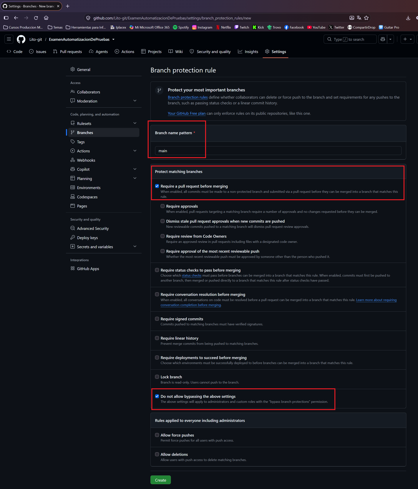

**Pipeline de CI con build, pruebas unitarias e integración**
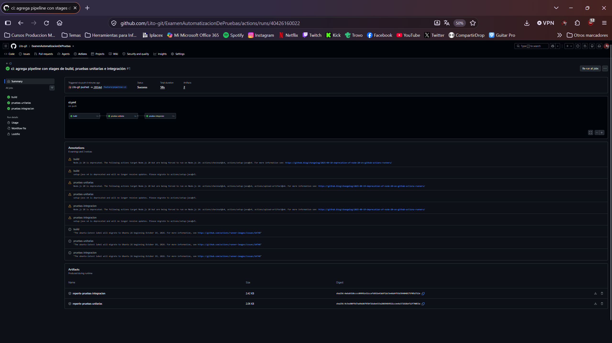

**Pruebas unitarias en CI**
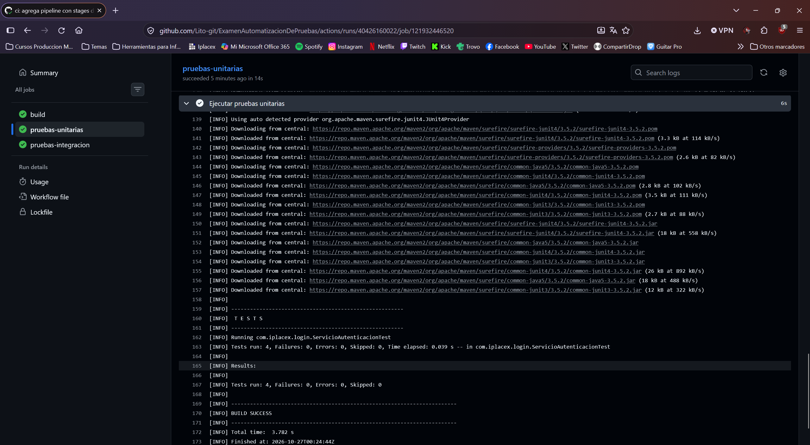

**Pruebas de integración en CI**
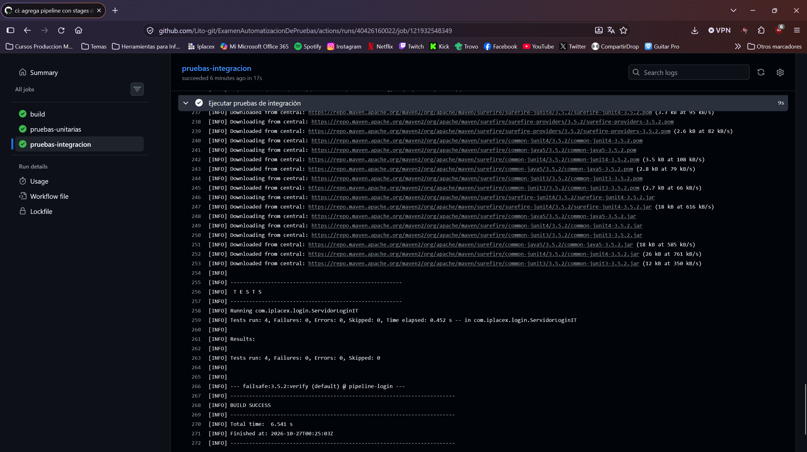

**Pull request con checks requeridos**
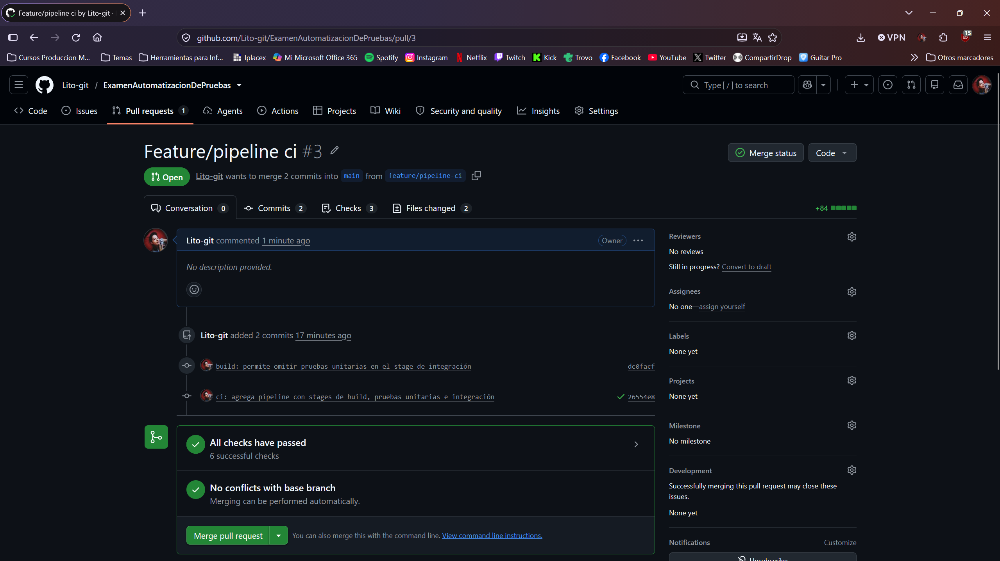

**Deployment pipeline completo**
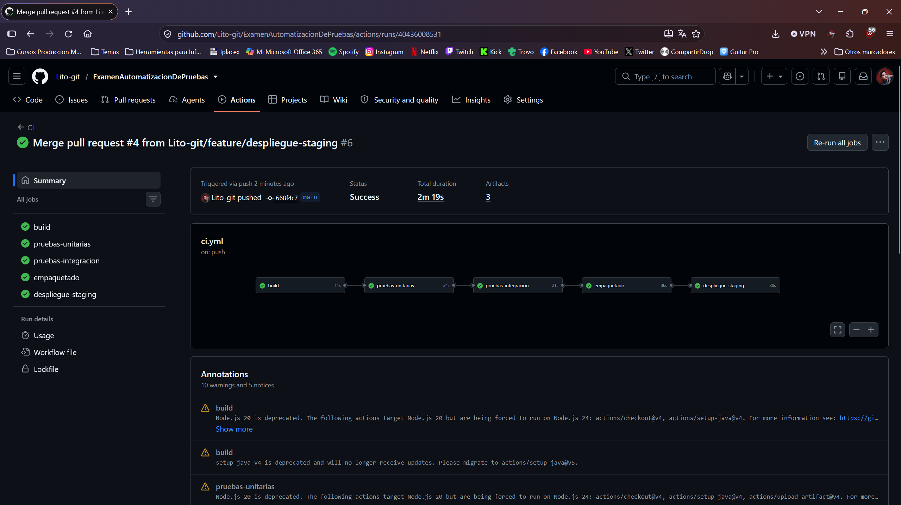

**Despliegue en staging y Acceptance Gate exitoso**
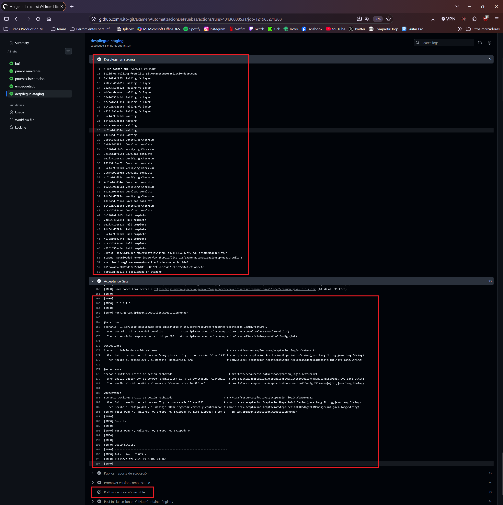

**Imágenes versionadas en el registro**
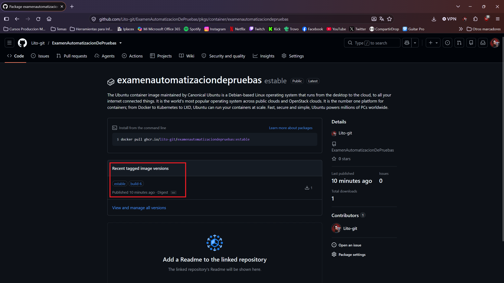

**Acceptance Gate fallido ante un despliegue defectuoso**
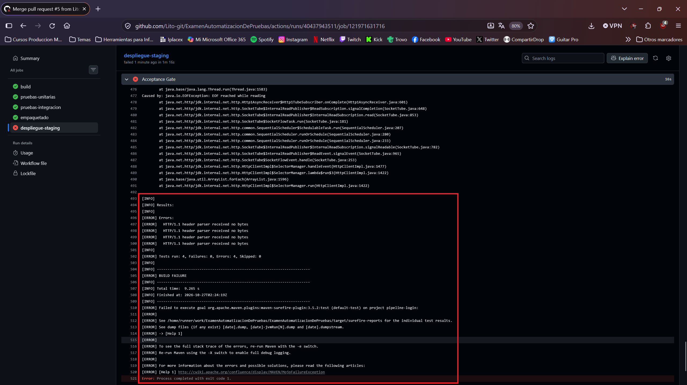

**Rollback automático a la versión estable**
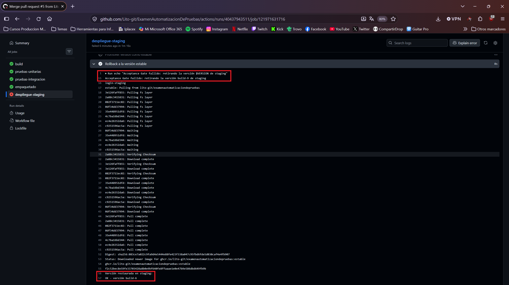

**Despliegue restablecido**
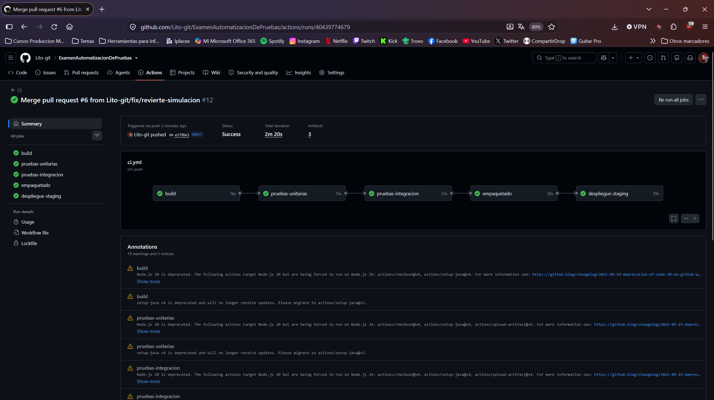